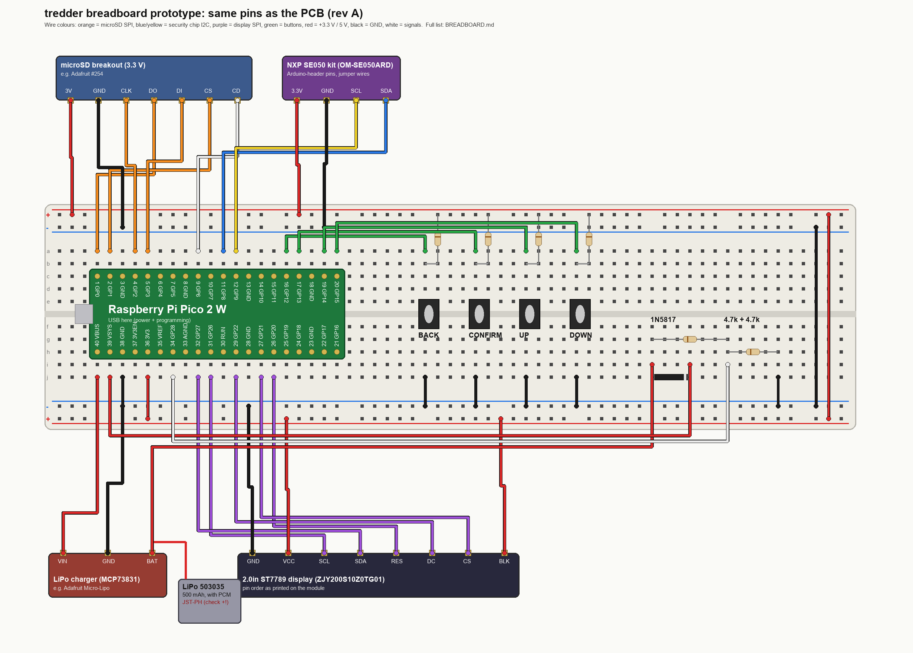

# Breadboard prototype (same pins as the PCB)

Generated by `hardware/tools/gen_breadboard.py` (picture: `breadboard.png`). Every signal uses the same Pico pin as the PCB, so the firmware built for the board runs here unchanged. Pin numbers are the Pico's physical pins (1-40), with its USB end on the left.

## Parts

| Qty | Part | Notes |
|---|---|---|
| 1 | Raspberry Pi Pico 2 W **with headers** ("Pico 2 WH") | Same module as on the PCB |
| 1-2 | Full-size breadboard (830 holes) + jumper wires | |
| 1 | 2.0in 240x320 IPS display, ST7789V, 8-pin **GND VCC SCL SDA RES DC CS BLK** (e.g. ZJY200S10Z0TG01) | The same module the PCB uses |
| 1 | NXP SE050 development kit **OM-SE050ARD** (Arduino-shield format, SE050C2 configuration) | The PCB's U2 is the bare SE050C2 chip. Wire it with male-female jumpers from its Arduino header (SDA, SCL, 3.3V, GND); set its jumpers for 3.3 V I2C per NXP AN12395. It has its own I2C pull-ups, so add none |
| 1 | microSD breakout that works at 3.3 V (e.g. Adafruit #254) | |
| 4 | 6 mm tactile push buttons | BACK, CONFIRM, UP, DOWN |
| 4 | 10 k resistors | Button pull-ups (as on the PCB) |
| 2 | 4.7 k resistors | Battery-voltage divider into GP28 (as on the PCB) |
| 1 | LiPo charger breakout with the MCP73831 (e.g. Adafruit Micro-Lipo) | Same charger chip as the PCB |
| 1 | 1S LiPo 503035, 500 mAh, with protection circuit, JST-PH lead | The same cell as the PCB |
| 1 | 1N5817 Schottky diode | Battery -> VSYS (Raspberry Pi's recommended battery hookup) |

## Wiring

Power rails: Pico pin 36 (3V3) -> **+ rail**, pin 38 (GND) -> **- rail**; join the top and bottom rails at the end.

| Pico pin | GPIO | Goes to | Signal |
|---|---|---|---|
| 1 | GP0 | microSD breakout **DO** | SD_MISO (SPI0 RX) |
| 2 | GP1 | microSD breakout **CS** | SD_CS |
| 4 | GP2 | microSD breakout **CLK** | SD_SCK (SPI0 SCK) |
| 5 | GP3 | microSD breakout **DI** | SD_MOSI (SPI0 TX) |
| 9 | GP6 | microSD breakout **CD** | SD_DET (card detect) |
| 11 | GP8 | SE050 kit **SDA** | SE_SDA (I2C0 SDA) |
| 12 | GP9 | SE050 kit **SCL** | SE_SCL (I2C0 SCL) |
| 31 | GP26 | Display **SCL** | LCD_SCK (SPI1 SCK) |
| 32 | GP27 | Display **SDA** | LCD_MOSI (SPI1 TX) |
| 26 | GP20 | Display **RES** | LCD_RST |
| 29 | GP22 | Display **DC** | LCD_DC |
| 27 | GP21 | Display **CS** | LCD_CS |
| 40 | VBUS | Charger **VIN** | VBUS: the Pico's USB 5 V feeds the charger |
| 16 | GP12 | BACK button (other leg to GND) + 10 k to 3V3 | BTN_BACK |
| 17 | GP13 | CONFIRM button (other leg to GND) + 10 k to 3V3 | BTN_CONFIRM |
| 19 | GP14 | UP button (other leg to GND) + 10 k to 3V3 | BTN_UP |
| 20 | GP15 | DOWN button (other leg to GND) + 10 k to 3V3 | BTN_DOWN |
| 39 | VSYS | 1N5817 cathode (anode to battery +) | battery power into the Pico |
| 34 | GP28 | middle of the 2 x 4.7 k divider (battery + to GND) | VBAT_SENSE (ADC) |

| Module pin | Goes to |
|---|---|
| microSD breakout **3V** | +3.3 V rail |
| microSD breakout **GND** | GND rail |
| SE050 kit **3.3V** | +3.3 V rail |
| SE050 kit **GND** | GND rail |
| Display **VCC** | +3.3 V rail |
| Display **GND** | GND rail |
| Display **BLK** | +3.3 V rail |
| Charger **GND** | GND rail |
| Charger **BAT** | battery + (and the diode's anode, and the top of the divider) |

## What the breadboard tests, and what it can't

**Tests** (same as the PCB): the display and its SPI wiring, all four buttons, the security chip on I2C, the microSD card and card detect, battery voltage reading, charging from the Pico's USB, running from the battery, the radio, and all of the firmware.

**Does not test** (PCB only):

- The power switches Q1-Q5. Here the display, security chip and SD card are always powered and the backlight is always on, so GP7, GP11, GP18 and GP19 switch nothing, and sleep current is higher. The SE050 has no reset pin (the PCB resets it by switching its power), so to reset it here, pull its 3.3V wire.
- The battery/USB switch Q1: the diode does the same job, with a 0.3 V drop.
- The PCB's USB-C port, fuse and USB protection (here the Pico's own micro-USB is used).
- The charge-status pin GP5 (most charger breakouts only drive an LED).

## Before powering it

1. **3.3 V only.** Never connect VBUS (5 V) to the display, the security chip or the 3.3 V rail.
2. **Check the display's pin order** printed on its back. If it differs from GND VCC SCL SDA RES DC CS BLK, wire by name, not by position.
3. **Check the battery lead polarity** before plugging it into the charger: red must go to +.
4. Use only public test phrases: a breadboard is not a secure device.
