# Hardware simulation report

Generated 2026-11-01 20:53 by `sim/run_all.py` from `tools/design.py` (ngspice from KiCad + behavioural models; see `sim/README.md` for what is and isn't modelled).

| Status | Test | What it checks |
|---|---|---|
| **PASS** | [pin_functions](#pin-functions) | RP2350 pin-function legality |
| **PASS** | [decoupling](#decoupling) | Every supply pin has local decoupling |
| **PASS** | [power_budget](#power-budget) | 3V3 power budget and battery life |
| **PASS** | [kicad_checks](#kicad-checks) | KiCad ERC, DRC and schematic/PCB parity |
| **PASS** | [reset_default_off](#reset-default-off) | Boot / reset: peripherals default OFF |
| **PASS** | [battery_boot](#battery-boot) | Power-on from battery (power switch flipped ON) |
| **PASS** | [usb_hotplug](#usb-hotplug) | USB-C hot-plug and unplug with battery (load sharing) |
| **PASS** | [switch_off_usb](#switch-off-usb) | Power switch OFF while charging |
| **PASS** | [off_drain](#off-drain) | Battery drain when switched OFF / idle |
| **PASS** | [charge_cycle](#charge-cycle) | Full charge cycle (CC -> CV -> complete) |
| **PASS** | [sd_power](#sd-power) | microSD power switch: soft-start, write load, power-off |
| **PASS** | [lcd_power](#lcd-power) | Display module power switch (Q5): sleep / wake |
| **PASS** | [se_power](#se-power) | Secure element power-up / hibernate |
| **PASS** | [i2c_timing](#i2c-timing) | I2C edge rates to the secure element |
| **PASS** | [buttons](#buttons) | Button debounce (contact bounce on CONFIRM) |
| **PASS** | [vbat_adc](#vbat-adc) | Battery voltage measurement (GP28 / ADC2) |
| **PASS** | [usb_cc](#usb-cc) | USB-C CC sink advertisement (Rd = 5.1 k) |
| **PASS** | [backlight_pwm](#backlight-pwm) | Display backlight PWM (Q4, active-low) |
| **PASS** | [worst_load](#worst-load) | Worst-case load on a low battery |

## pin_functions

**RP2350 pin-function legality** - PASS (0.0 s)

Every bus signal must land on a GPIO whose hardware mux offers that function, and the SD and display must sit on different SPI blocks.

| Result | Check | Value | Limit |
|---|---|---|---|
| PASS | SD_MISO on GP0 -> SPI0_RX | SPI0_RX  | == SPI0_RX |
| PASS | SD_SCK on GP2 -> SPI0_SCK | SPI0_SCK  | == SPI0_SCK |
| PASS | SD_MOSI on GP3 -> SPI0_TX | SPI0_TX  | == SPI0_TX |
| PASS | LCD_SCK on GP26 -> SPI1_SCK | SPI1_SCK  | == SPI1_SCK |
| PASS | LCD_MOSI on GP27 -> SPI1_TX | SPI1_TX  | == SPI1_TX |
| PASS | SE_SDA on GP8 -> I2C0_SDA | I2C0_SDA  | == I2C0_SDA |
| PASS | SE_SCL on GP9 -> I2C0_SCL | I2C0_SCL  | == I2C0_SCL |
| PASS | UART_TX on GP16 -> UART0_TX | UART0_TX  | == UART0_TX |
| PASS | UART_RX on GP17 -> UART0_RX | UART0_RX  | == UART0_RX |
| PASS | VBAT_SENSE on GP28 -> GP28 | GP28  | == ADC |
| PASS | microSD and display on separate SPI peripherals | {'SPI0'} / {'SPI1'}  | disjoint |
| PASS | GP23 unused (wired to CYW43 radio inside the module) | False  | absent |
| PASS | GP24 unused (wired to CYW43 radio inside the module) | False  | absent |
| PASS | GP25 unused (wired to CYW43 radio inside the module) | False  | absent |
| PASS | GP29 unused (wired to CYW43 radio inside the module) | False  | absent |

## decoupling

**Every supply pin has local decoupling** - PASS (0.0 s)

Each IC/module supply net must carry at least one capacitor.

| Result | Check | Value | Limit |
|---|---|---|---|
| PASS | U2 OPTIGA VCC (SE_VCC) | C4, C5  | >= 1 capacitor |
| PASS | U3 charger VDD (VBUS) | C1  | >= 1 capacitor |
| PASS | U3 charger VBAT (VBAT) | C2  | >= 1 capacitor |
| PASS | J3 microSD VDD (SD_VDD) | C6, C7  | >= 1 capacitor |
| PASS | J4 display VCC (+3V3) | C14, C15, C8, C17  | >= 1 capacitor |
| PASS | A1 VSYS (VSYS) | C3  | >= 1 capacitor |
| PASS | A1 3V3 (+3V3) | C14, C15, C8, C17  | >= 1 capacitor |

## power_budget

**3V3 power budget and battery life** - PASS (0.0 s)

Worst-case simultaneous loads on the Pico's 3V3 output (Raspberry Pi recommends <= 300 mA), and battery life estimates for a 1000 mAh cell.

| Result | Check | Value | Limit |
|---|---|---|---|
| INFO | RP2350 + flash, both cores busy | 45 mA |  |
| INFO | CYW43439 BLE TX peak | 60 mA |  |
| INFO | Display logic | 8 mA |  |
| INFO | Backlight (full) | 30 mA |  |
| INFO | microSD write peak | 100 mA |  |
| INFO | OPTIGA active | 10 mA |  |
| INFO | Pull-ups, dividers | 2 mA |  |
| PASS | Total worst-case 3V3 load | 255 mA | <= 300 mA |
| INFO | Active (screen on, BLE connected): battery current / runtime on 1000 mAh | 76 mA / 13.2 h  |  |
| INFO | Idle, screen off, BLE advertising: battery current / runtime on 1000 mAh | 12 mA / 82.2 h  |  |

## kicad_checks

**KiCad ERC, DRC and schematic/PCB parity** - PASS (5.1 s)

Runs kicad-cli on the real project files.

| Result | Check | Value | Limit |
|---|---|---|---|
| PASS | ERC errors | 0  | == 0 |
| PASS | ERC warnings | 0  | == 0 |
| PASS | Unrouted connections | 0  | == 0 |
| PASS | Copper DRC errors (clearance/short/crossing/edge) | 0  | == 0 |
| PASS | Schematic <-> PCB parity issues | 0  | == 0 |
| INFO | Other DRC error classes (see README: known/benign) | items_not_allowed, starved_thermal  |  |

## reset_default_off

**Boot / reset: peripherals default OFF** - PASS (0.2 s)

All GPIOs in RP2350 reset state (input, pull-DOWN 36-113 k). The SE, microSD, display power and backlight switches must stay OFF until firmware turns them on. Swept over pull-down and AO3401A Vth corners.

| Result | Check | Value | Limit |
|---|---|---|---|
| PASS | SE_VCC at reset (RPD 36k, Vth -0.5 V) | 6.539e-07 V | <= 0.3 V |
| PASS | SD_VDD at reset (RPD 36k, Vth -0.5 V) | 1.166e-07 V | <= 0.3 V |
| PASS | LCD_VCC at reset (RPD 36k, Vth -0.5 V) | 0.003786 V | <= 0.3 V |
| PASS | Backlight current at reset (RPD 36k, Vth -0.5 V) | 2.533e-12 mA | <= 1 mA |
| PASS | SE_VCC at reset (RPD 36k, Vth -0.9 V) | 6.539e-07 V | <= 0.3 V |
| PASS | SD_VDD at reset (RPD 36k, Vth -0.9 V) | 1.166e-07 V | <= 0.3 V |
| PASS | LCD_VCC at reset (RPD 36k, Vth -0.9 V) | 0.003786 V | <= 0.3 V |
| PASS | Backlight current at reset (RPD 36k, Vth -0.9 V) | 2.533e-12 mA | <= 1 mA |
| PASS | BTN_UP idle level with reset pull-down (reads 'not pressed') | 2.581 V | >= 2 V |
| PASS | BTN_DOWN idle level with reset pull-down (reads 'not pressed') | 2.581 V | >= 2 V |
| PASS | BTN_BACK idle level with reset pull-down (reads 'not pressed') | 2.581 V | >= 2 V |
| PASS | BTN_CONFIRM idle level with reset pull-down (reads 'not pressed') | 2.581 V | >= 2 V |
| PASS | SE_VCC at reset (RPD 36k, Vth -1.3 V) | 6.539e-07 V | <= 0.3 V |
| PASS | SD_VDD at reset (RPD 36k, Vth -1.3 V) | 1.166e-07 V | <= 0.3 V |
| PASS | LCD_VCC at reset (RPD 36k, Vth -1.3 V) | 0.003786 V | <= 0.3 V |
| PASS | Backlight current at reset (RPD 36k, Vth -1.3 V) | 2.533e-12 mA | <= 1 mA |
| PASS | SE_VCC at reset (RPD 113k, Vth -0.5 V) | 1.239e-06 V | <= 0.3 V |
| PASS | SD_VDD at reset (RPD 113k, Vth -0.5 V) | 3.117e-07 V | <= 0.3 V |
| PASS | LCD_VCC at reset (RPD 113k, Vth -0.5 V) | 0.003786 V | <= 0.3 V |
| PASS | Backlight current at reset (RPD 113k, Vth -0.5 V) | 2.533e-12 mA | <= 1 mA |
| PASS | SE_VCC at reset (RPD 113k, Vth -0.9 V) | 1.239e-06 V | <= 0.3 V |
| PASS | SD_VDD at reset (RPD 113k, Vth -0.9 V) | 3.117e-07 V | <= 0.3 V |
| PASS | LCD_VCC at reset (RPD 113k, Vth -0.9 V) | 0.003786 V | <= 0.3 V |
| PASS | Backlight current at reset (RPD 113k, Vth -0.9 V) | 2.533e-12 mA | <= 1 mA |
| PASS | SE_VCC at reset (RPD 113k, Vth -1.3 V) | 1.239e-06 V | <= 0.3 V |
| PASS | SD_VDD at reset (RPD 113k, Vth -1.3 V) | 3.117e-07 V | <= 0.3 V |
| PASS | LCD_VCC at reset (RPD 113k, Vth -1.3 V) | 0.003786 V | <= 0.3 V |
| PASS | Backlight current at reset (RPD 113k, Vth -1.3 V) | 2.533e-12 mA | <= 1 mA |

## battery_boot

**Power-on from battery (power switch flipped ON)** - PASS (0.2 s)

Battery 3.7 V and 3.4 V, no USB, power switch turned ON at 1 ms.

| Result | Check | Value | Limit |
|---|---|---|---|
| PASS | [VBAT 3.7 V] 3V3 reaches 3.2 V after switch-on | 1.079 ms | <= 5 ms |
| PASS | [VBAT 3.7 V] 3V3 steady state | 3.298 V | 3.2 .. 3.4 V |
| PASS | [VBAT 3.7 V] 3V3 overshoot | 3.298 V | <= 3.6 V |
| INFO | [VBAT 3.7 V] battery current, idle (MCU 60 mA) | 62.58 mA |  |
| PASS | [VBAT 3.7 V] SE_VCC glitch during power-up (GPIOs in reset) | 0.0006686 V | <= 0.3 V |
| PASS | [VBAT 3.7 V] SD_VDD glitch during power-up (GPIOs in reset) | 5.112e-05 V | <= 0.3 V |
| PASS | [VBAT 3.7 V] backlight current during power-up | 0.0005815 mA | <= 1 mA |
| PASS | [abs max] RP2350 FT pin margin vs 5.5 V powered / 3.63 V unpowered (worst: GP7 SD_PWR_N) | -0.6811 V | <= 0 V |
| PASS | [abs max] RP2350 ADC pin above IOVDD+0.5 (worst: GP28) | -0.2758 V | <= 0 V |
| PASS | [abs max] OPTIGA VCC | 0.0006686 V | <= 5.5 V |
| PASS | [abs max] microSD VDD | 5.112e-05 V | <= 3.6 V |
| PASS | [abs max] MCP73831 VDD (VBUS) | 0.004587 V | <= 7 V |
| PASS | [VBAT 3.4 V] 3V3 reaches 3.2 V after switch-on | 1.08 ms | <= 5 ms |
| PASS | [VBAT 3.4 V] 3V3 steady state | 3.298 V | 3.2 .. 3.4 V |
| PASS | [VBAT 3.4 V] 3V3 overshoot | 3.298 V | <= 3.6 V |
| INFO | [VBAT 3.4 V] battery current, idle (MCU 60 mA) | 68.09 mA |  |
| PASS | [VBAT 3.4 V] SE_VCC glitch during power-up (GPIOs in reset) | 0.0006686 V | <= 0.3 V |
| PASS | [VBAT 3.4 V] SD_VDD glitch during power-up (GPIOs in reset) | 5.112e-05 V | <= 0.3 V |
| PASS | [VBAT 3.4 V] backlight current during power-up | 0.0005816 mA | <= 1 mA |
| PASS | [abs max] RP2350 FT pin margin vs 5.5 V powered / 3.63 V unpowered (worst: GP7 SD_PWR_N) | -0.6804 V | <= 0 V |
| PASS | [abs max] RP2350 ADC pin above IOVDD+0.5 (worst: GP28) | -0.291 V | <= 0 V |
| PASS | [abs max] OPTIGA VCC | 0.0006686 V | <= 5.5 V |
| PASS | [abs max] microSD VDD | 5.112e-05 V | <= 3.6 V |
| PASS | [abs max] MCP73831 VDD (VBUS) | 0.00455 V | <= 7 V |

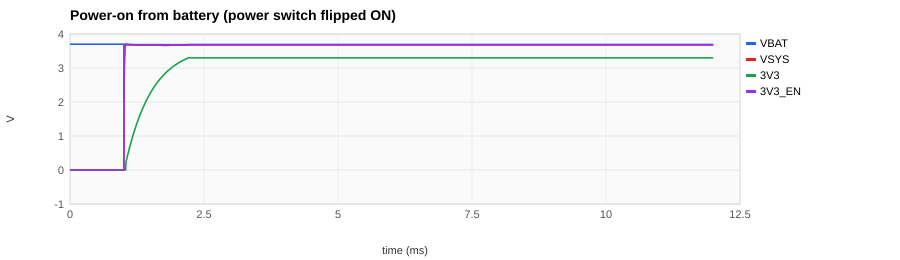

## usb_hotplug

**USB-C hot-plug and unplug with battery (load sharing)** - PASS (6.5 s)

Battery 3.7 V, switch ON, MCU running. A live 5 V charger is hot-plugged through a cable of 1 uH / 0.1 Ohm (worst-case ringing) and later unplugged. Ringing is simulated with a 5 ns step for both ends of the PTC fuse range (0.15 / 0.3 Ohm).

| Result | Check | Value | Limit |
|---|---|---|---|
| PASS | [PTC 0.15 Ohm] peak VBUS_C at USB-C connector (before F1) | 5.367 V | <= 6 V |
| PASS | [PTC 0.15 Ohm] peak VBUS on board (Pico VBUS/VSYS, charger) | 4.898 V | <= 5.5 V |
| PASS | [PTC 0.15 Ohm] peak VBUS on board (abs max) | 4.898 V | <= 6 V |
| PASS | [abs max] RP2350 FT pin margin vs 5.5 V powered / 3.63 V unpowered (worst: GP11 SE_PWR_N) | -2.392 V | <= 0 V |
| PASS | [abs max] RP2350 ADC pin above IOVDD+0.5 (worst: GP28) | -2.036 V | <= 0 V |
| PASS | [abs max] OPTIGA VCC | 6.539e-07 V | <= 5.5 V |
| PASS | [abs max] microSD VDD | 1.166e-07 V | <= 3.6 V |
| PASS | [abs max] MCP73831 VDD (VBUS) | 4.898 V | <= 7 V |
| PASS | [PTC 0.3 Ohm] peak VBUS_C at USB-C connector (before F1) | 5.585 V | <= 6 V |
| PASS | [PTC 0.3 Ohm] peak VBUS on board (Pico VBUS/VSYS, charger) | 4.751 V | <= 5.5 V |
| PASS | [PTC 0.3 Ohm] peak VBUS on board (abs max) | 4.751 V | <= 6 V |
| PASS | [abs max] RP2350 FT pin margin vs 5.5 V powered / 3.63 V unpowered (worst: GP19 LCD_BL_N) | -2.392 V | <= 0 V |
| PASS | [abs max] RP2350 ADC pin above IOVDD+0.5 (worst: GP28) | -2.036 V | <= 0 V |
| PASS | [abs max] OPTIGA VCC | 6.539e-07 V | <= 5.5 V |
| PASS | [abs max] microSD VDD | 1.166e-07 V | <= 3.6 V |
| PASS | [abs max] MCP73831 VDD (VBUS) | 4.751 V | <= 7 V |
| PASS | 3V3 minimum across plug + unplug | 3.298 V | >= 3.2 V |
| PASS | VSYS minimum after unplug (RT6154 needs >= 1.8 V) | 3.038 V | >= 2.5 V |
| PASS | Battery charge current while USB present (system runs from USB) | 0.4993 A | 0.45 .. 0.55 A |
| PASS | Q1 Vgs while USB present (FET off: gate above source) | 0.2798 V | >= 0 V |
| INFO | Time Q1 body diode carries the load after unplug (VSYS < VBAT - 0.3 V) | 7.5 ms |  |
| PASS | [abs max] RP2350 FT pin margin vs 5.5 V powered / 3.63 V unpowered (worst: GP19 LCD_BL_N) | -2.392 V | <= 0 V |
| PASS | [abs max] RP2350 ADC pin above IOVDD+0.5 (worst: GP28) | -2.033 V | <= 0 V |
| PASS | [abs max] OPTIGA VCC | 6.539e-07 V | <= 5.5 V |
| PASS | [abs max] microSD VDD | 1.166e-07 V | <= 3.6 V |
| PASS | [abs max] MCP73831 VDD (VBUS) | 4.751 V | <= 7 V |

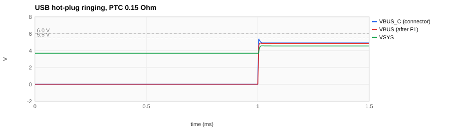

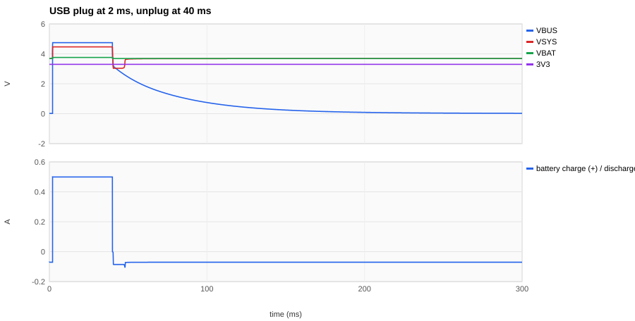

## switch_off_usb

**Power switch OFF while charging** - PASS (0.2 s)

SW1 OFF (battery disconnected from system, 3V3_EN grounded) with USB attached. The device must be completely off but still charge. Worst case: VBUS 5.5 V and a full battery (charger STAT drives VBUS-level 'complete' into the divider).

| Result | Check | Value | Limit |
|---|---|---|---|
| PASS | [VBUS 5.0 V, battery half] 3V3 (must stay off) | 2.522e-13 V | <= 0.3 V |
| PASS | [VBUS 5.0 V, battery half] charge current with switch OFF | 0.4998 A | 0.45 .. 0.55 A |
| PASS | [VBUS 5.0 V, battery half] CHG_STAT into UNPOWERED RP2350 GP5 (FT limit 3.63 V) | 0.08335 V | <= 3.63 V |
| PASS | [abs max] RP2350 FT pin margin vs 5.5 V powered / 3.63 V unpowered (worst: GP5 CHG_STAT) | -3.547 V | <= 0 V |
| PASS | [abs max] RP2350 ADC pin above IOVDD+0.5 (worst: GP28) | -0.5 V | <= 0 V |
| PASS | [abs max] OPTIGA VCC | 3.403e-15 V | <= 5.5 V |
| PASS | [abs max] microSD VDD | 8.589e-16 V | <= 3.6 V |
| PASS | [abs max] MCP73831 VDD (VBUS) | 4.774 V | <= 7 V |
| PASS | [VBUS 5.5 V, battery full] 3V3 (must stay off) | 2.745e-13 V | <= 0.3 V |
| PASS | [VBUS 5.5 V, battery full] CHG_STAT into UNPOWERED RP2350 GP5 (FT limit 3.63 V) | 3.293 V | <= 3.63 V |
| PASS | [abs max] RP2350 FT pin margin vs 5.5 V powered / 3.63 V unpowered (worst: GP5 CHG_STAT) | -0.3368 V | <= 0 V |
| PASS | [abs max] RP2350 ADC pin above IOVDD+0.5 (worst: GP28) | -0.5 V | <= 0 V |
| PASS | [abs max] OPTIGA VCC | 3.703e-15 V | <= 5.5 V |
| PASS | [abs max] microSD VDD | 9.347e-16 V | <= 3.6 V |
| PASS | [abs max] MCP73831 VDD (VBUS) | 5.5 V | <= 7 V |

## off_drain

**Battery drain when switched OFF / idle** - PASS (0.0 s)

No USB. SW1 OFF: battery must see only charger leakage. SW1 ON with firmware asleep is reported for reference (model MCU load 1 mA).

| Result | Check | Value | Limit |
|---|---|---|---|
| PASS | Battery current, switch OFF | 0.759 uA | <= 5 uA |
| INFO | Shelf life of 1000 mAh cell from this drain alone | 150.4 years |  |
| PASS | Battery current in SLEEP (switch ON, MCU 1 mA dormant, display + SE + SD unpowered) | 2.556 mA | <= 3 mA |
| INFO | Sleep time of a 500 mAh cell (BT1) from this drain | 8.15 days |  |
| INFO | Same, display module left powered (no Q5 / firmware forgets): module logic load | 14.09 mA |  |

## charge_cycle

**Full charge cycle (CC -> CV -> complete)** - PASS (0.2 s)

Battery capacity scaled to 2 mAh so a full CC/CV cycle fits in 40 s of simulated time (currents and voltages are those of the real circuit). Firmware reads GP5 as input.

| Result | Check | Value | Limit |
|---|---|---|---|
| PASS | Constant-current phase current (R5 sets 1000/R5) | 0.4993 A | 0.45 .. 0.55 A |
| PASS | Maximum VBAT (CV regulation 4.20 V) | 4.2 V | <= 4.25 V |
| PASS | CHG_STAT level while charging (must read LOW) | 0.08396 V | <= 0.8 V |
| PASS | CHG_STAT level when complete (must read HIGH) | 2.981 V | >= 2 V |
| PASS | Charge LED current while charging | 2.76 mA | 1 .. 6 mA |
| INFO | Time to 'complete' (2 mAh scaled cell) | 15.77 s |  |
| PASS | [abs max] RP2350 FT pin margin vs 5.5 V powered / 3.63 V unpowered (worst: GP11 SE_PWR_N) | -2.392 V | <= 0 V |
| PASS | [abs max] RP2350 ADC pin above IOVDD+0.5 (worst: GP28) | -1.826 V | <= 0 V |
| PASS | [abs max] OPTIGA VCC | 6.539e-07 V | <= 5.5 V |
| PASS | [abs max] microSD VDD | 1.166e-07 V | <= 3.6 V |
| PASS | [abs max] MCP73831 VDD (VBUS) | 4.978 V | <= 7 V |

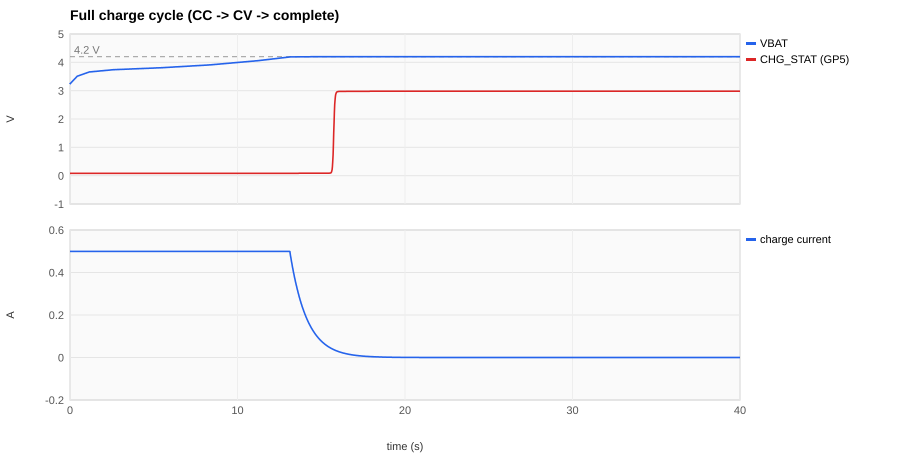

## sd_power

**microSD power switch: soft-start, write load, power-off** - PASS (0.4 s)

Firmware: GP7 low at 2 ms (SD on), card writes 60 mA 10-20 ms, GP7 high at 30 ms (off). SPI lines driven low after power-off (correct firmware). A second run leaves CS high after power-off (firmware mistake) to show back-powering.

| Result | Check | Value | Limit |
|---|---|---|---|
| PASS | SD_VDD ramp 10-90 % (SD spec: 0.1 .. 35 ms) | 0.718 ms | 0.1 .. 35 ms |
| PASS | SD_VDD while on, during 60 mA write | 3.289 V | >= 3.2 V |
| PASS | 3V3 minimum at SD switch-on (rail stays in spec) | 3.29 V | >= 3.2 V |
| INFO | Inrush from 3V3 rail above baseline | 181.4 mA |  |
| INFO | 3V3 droop at SD switch-on | 9.697 mV |  |
| RULE | SD_VDD fall below 0.5 V after power-off (card reset needs < 0.5 V for >= 1 ms) | 132.3 ms |  |
| PASS | [abs max] RP2350 FT pin margin vs 5.5 V powered / 3.63 V unpowered (worst: GP7 SD_PWR_N) | -2.202 V | <= 0 V |
| PASS | [abs max] RP2350 ADC pin above IOVDD+0.5 (worst: GP28) | -2.064 V | <= 0 V |
| PASS | [abs max] OPTIGA VCC | 7.249e-07 V | <= 5.5 V |
| PASS | [abs max] microSD VDD | 3.298 V | <= 3.6 V |
| PASS | [abs max] MCP73831 VDD (VBUS) | 0.01818 V | <= 7 V |
| RULE | FIRMWARE MISTAKE: SD_VDD with card 'off' but CS left high (back-powered through card I/O) | 2.621 V |  |

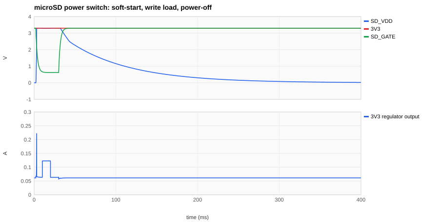

## lcd_power

**Display module power switch (Q5): sleep / wake** - PASS (0.3 s)

Firmware: GP18 low at 2 ms (display on), LCD pins driven after 5 ms, pins LOW at 29 ms, GP18 high at 30 ms (sleep). Second run leaves CS/DC high after power-off (firmware mistake).

| Result | Check | Value | Limit |
|---|---|---|---|
| PASS | LCD_VCC reaches 90 % (then the driver may send SWRESET) | 1.244 ms | <= 3 ms |
| INFO | LCD_VCC ramp 10-90 % | 0.2454 ms |  |
| PASS | 3V3 minimum at display switch-on (rail stays in spec) | 3.283 V | >= 3.2 V |
| INFO | 3V3 droop at display switch-on | 17.01 mV |  |
| RULE | LCD_VCC below 0.3 V after power-off | 999 ms |  |
| PASS | [abs max] RP2350 FT pin margin vs 5.5 V powered / 3.63 V unpowered (worst: GP22 LCD_DC) | -2.202 V | <= 0 V |
| PASS | [abs max] RP2350 ADC pin above IOVDD+0.5 (worst: GP28) | -2.064 V | <= 0 V |
| PASS | [abs max] OPTIGA VCC | 6.864e-07 V | <= 5.5 V |
| PASS | [abs max] microSD VDD | 1.184e-07 V | <= 3.6 V |
| PASS | [abs max] MCP73831 VDD (VBUS) | 0.01818 V | <= 7 V |
| RULE | FIRMWARE MISTAKE: LCD_VCC with display 'off' but CS/DC left high (back-powered through ESD diodes) | 2.514 V |  |

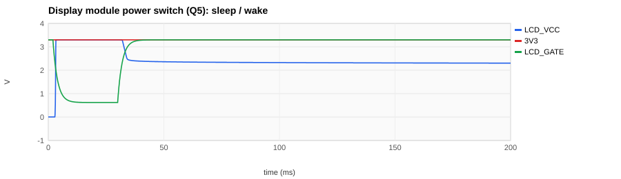

## se_power

**Secure element power-up / hibernate** - PASS (0.5 s)

GP11 low at 1 ms (SE on), RST released at 2 ms; at 20 ms RST low then GP11 high (off). Second run: firmware forgets to pull RST low before power-off.

| Result | Check | Value | Limit |
|---|---|---|---|
| PASS | SE_VCC reaches 3.2 V after enable | 0.0006353 ms | <= 1 ms |
| PASS | 3V3 minimum at SE switch-on (rail stays in spec) | 3.209 V | >= 3.2 V |
| INFO | 3V3 droop at SE switch-on | 91 mV |  |
| RULE | SE_VCC below 0.3 V after power-off (hibernate) | 132 ms |  |
| PASS | [abs max] RP2350 FT pin margin vs 5.5 V powered / 3.63 V unpowered (worst: GP10 SE_RST_N) | -2.202 V | <= 0 V |
| PASS | [abs max] RP2350 ADC pin above IOVDD+0.5 (worst: GP28) | -1.977 V | <= 0 V |
| PASS | [abs max] OPTIGA VCC | 3.298 V | <= 5.5 V |
| PASS | [abs max] microSD VDD | 1.175e-07 V | <= 3.6 V |
| PASS | [abs max] MCP73831 VDD (VBUS) | 0.01818 V | <= 7 V |
| RULE | FIRMWARE MISTAKE: SE_VCC 'off' with RST left high (fed through internal pull-up, assumed 50 k) | 1.519 V |  |

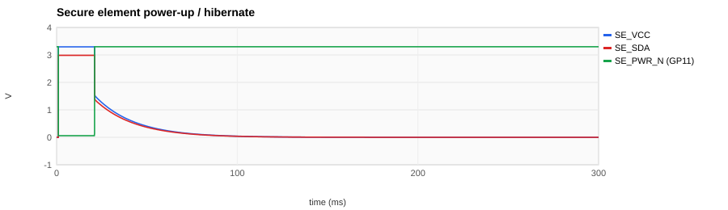

## i2c_timing

**I2C edge rates to the secure element** - PASS (0.5 s)

SE powered, MCU pulls SDA (open-drain) at 400 kHz. Bus = MCU pin 5 pF + SE 10 pF + trace 15 pF (assumed). I2C spec rise time (30->70 %): Fm <= 300 ns, Fm+ <= 120 ns.

| Result | Check | Value | Limit |
|---|---|---|---|
| PASS | SDA rise time 30->70 % (Fast-mode 400 kHz) | 119.7 ns | <= 300 ns |
| PASS | SDA rise time 30->70 % (Fast-mode Plus 1 MHz) | 119.7 ns | <= 120 ns |
| PASS | SDA low level (VOL) | 0.02782 V | <= 0.4 V |

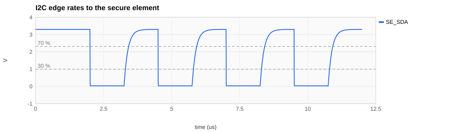

## buttons

**Button debounce (contact bounce on CONFIRM)** - PASS (0.6 s)

CONFIRM pressed at 1 ms with 4 bounces over 0.4 ms, released at 20 ms with 4 bounces. GPIO input (pulls off). Logic level decided with VIL 0.8 V / VIH 2.0 V hysteresis.

| Result | Check | Value | Limit |
|---|---|---|---|
| PASS | Logic transitions seen by firmware (expect exactly 2: press + release) | 2  | == 2 |
| PASS | Press detected after first contact | -0.02982 us | <= 100 us |
| PASS | Release detected after last bounce | 0.9329 ms | <= 5 ms |
| PASS | Pressed level | 3.298e-05 V | <= 0.8 V |

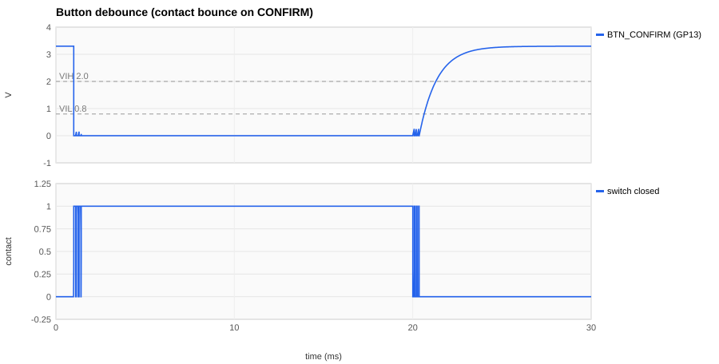

## vbat_adc

**Battery voltage measurement (GP28 / ADC2)** - PASS (0.0 s)

Battery swept 3.0-4.2 V. Firmware assumes the nominal divider ratio. The RP2350 ADC input impedance is only specified as >= 100 k, so both an ideal ADC and a 100 k ADC are simulated.

| Result | Check | Value | Limit |
|---|---|---|---|
| PASS | Worst-case uncalibrated VBAT error (ADC Rin 100 k .. ideal) | 2.296 % | <= 5 % |
| INFO | Error with ideal ADC | 0.0004699 % |  |
| INFO | Error with 100 k ADC input | 2.296 % |  |
| INFO | Divider current at 4.2 V (flows only while SW1 is ON) | 317.8 uA |  |

## usb_cc

**USB-C CC sink advertisement (Rd = 5.1 k)** - PASS (0.3 s)

Source Rp per USB Type-C spec (pull-up to 5 V): 56 k default USB, 22 k 1.5 A, 10 k 3 A; both plug orientations. CC voltage must fall inside the spec's vRd windows so the charger enables VBUS and the sink can read the current capability.

| Result | Check | Value | Limit |
|---|---|---|---|
| PASS | Rp 56k, normal plug: CC voltage | 0.4173 V | 0.25 .. 0.61 V |
| PASS | Rp 56k, flipped plug: CC voltage | 0.4173 V | 0.25 .. 0.61 V |
| PASS | Rp 22k, normal plug: CC voltage | 0.941 V | 0.7 .. 1.16 V |
| PASS | Rp 22k, flipped plug: CC voltage | 0.941 V | 0.7 .. 1.16 V |
| PASS | Rp 10k, normal plug: CC voltage | 1.689 V | 1.31 .. 2.04 V |
| PASS | Rp 10k, flipped plug: CC voltage | 1.689 V | 1.31 .. 2.04 V |

## backlight_pwm

**Display backlight PWM (Q4, active-low)** - PASS (0.5 s)

GP19 drives 1 kHz, 50 % duty (low = on).

| Result | Check | Value | Limit |
|---|---|---|---|
| PASS | Backlight current when on | 30.82 mA | 10 .. 40 mA |
| PASS | PWM duty error at 1 kHz | 0.009249 % pts | <= 2 % pts |
| PASS | Backlight turn-on time 10-90 % | 0.001815 us | <= 20 us |
| PASS | [abs max] RP2350 FT pin margin vs 5.5 V powered / 3.63 V unpowered (worst: GP19 LCD_BL_N) | -2.202 V | <= 0 V |
| PASS | [abs max] RP2350 ADC pin above IOVDD+0.5 (worst: GP28) | -2.065 V | <= 0 V |
| PASS | [abs max] OPTIGA VCC | 6.597e-07 V | <= 5.5 V |
| PASS | [abs max] microSD VDD | 1.169e-07 V | <= 3.6 V |
| PASS | [abs max] MCP73831 VDD (VBUS) | 0.01818 V | <= 7 V |

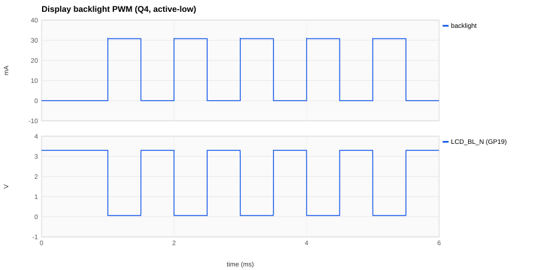

## worst_load

**Worst-case load on a low battery** - PASS (0.2 s)

Battery 3.4 V (almost empty), no USB. MCU 80 mA + BLE TX bursts 60 mA for 1 ms every 4 ms, SD card writing 100 mA, backlight on, SE on. Pico datasheet recommends <= 300 mA from 3V3.

| Result | Check | Value | Limit |
|---|---|---|---|
| PASS | 3V3 minimum | 3.289 V | >= 3.15 V |
| PASS | VSYS minimum | 3.322 V | >= 2.5 V |
| PASS | Peak 3V3 output current | 284 mA | <= 300 mA |
| INFO | Peak battery current | 0.3198 A |  |
| PASS | [abs max] RP2350 FT pin margin vs 5.5 V powered / 3.63 V unpowered (worst: GP10 SE_RST_N) | -2.209 V | <= 0 V |
| PASS | [abs max] RP2350 ADC pin above IOVDD+0.5 (worst: GP28) | -2.213 V | <= 0 V |
| PASS | [abs max] OPTIGA VCC | 3.29 V | <= 5.5 V |
| PASS | [abs max] microSD VDD | 3.281 V | <= 3.6 V |
| PASS | [abs max] MCP73831 VDD (VBUS) | 0.01818 V | <= 7 V |

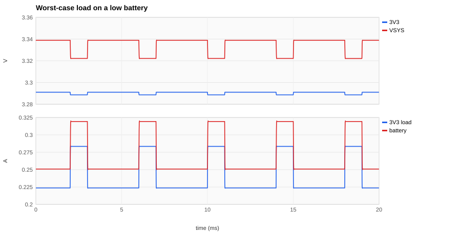
